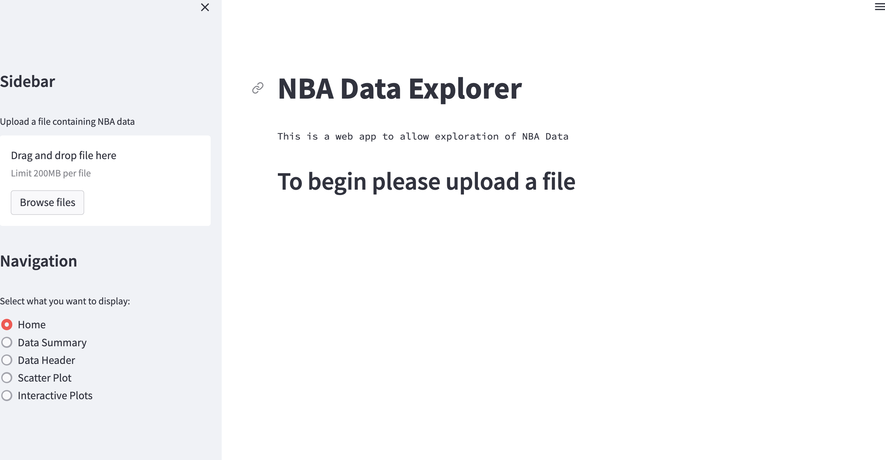
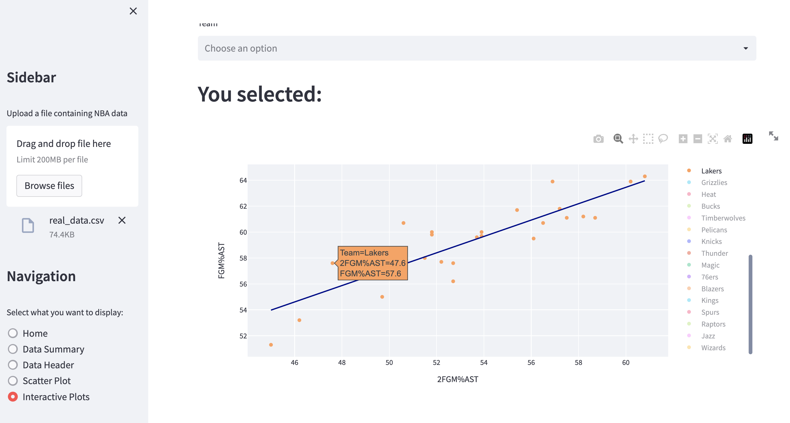

# ProPredict

A simple web app for looking at NBA team and player stats, drawing charts, and estimating what a stat might look like next season.



## Try it

[Launch your own copy](https://share.streamlit.io/deploy?repository=LiamBlack3/ProPredict&branch=master&mainModule=streamlit_app.py) (sign in with GitHub, then click Deploy).

## What you can do

1. Open the bundled NBA data, or upload your own spreadsheet.
2. Browse the numbers and pick a team or player.
3. Chart two stats against each other. The green line is the overall trend.
4. Ask for a next-season estimate and see how three simple models compare.



The next-season number is a trend from past seasons, not a full player projection. Injuries, role changes, and teammates are not in the model.

## Run it on your computer

You need Python installed. In a terminal, from this folder:

```bash
pip install -r requirements.txt
streamlit run streamlit_app.py
```

A browser window should open. Leave **Use bundled NBA sample data** turned on to start.

## Data

Sample files in `data/` cover NBA seasons from 2000 to 2021. Your own file should be a CSV with a `YEAR` column, plus `TEAM` (and `Player` for player stats).
