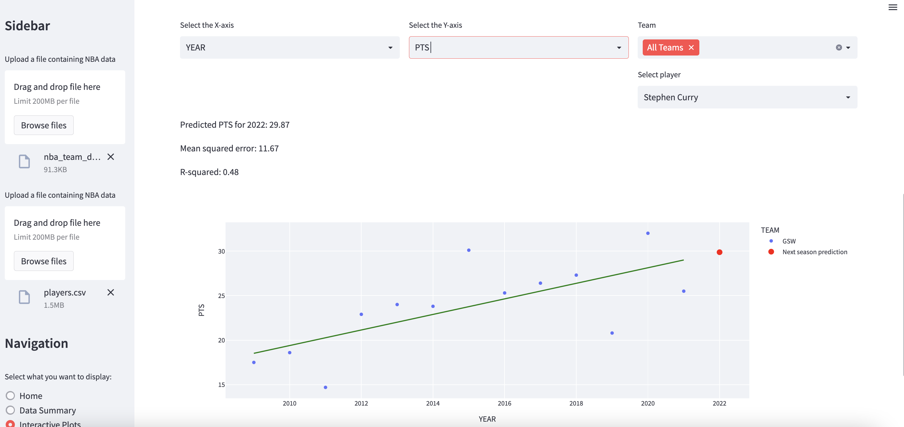

# ProPredict

Interactive NBA analytics app: explore team and player season stats, quantify relationships with OLS, and produce a next-season **trend forecast** that is scored on a held-out year.

Built as a thesis sports-analytics tool and updated as a portfolio project with a clearer modeling contract, temporal validation, and a reproducible Python layout.


## Why it exists

Front-office and fan analysis both start the same way: slice a season table, ask whether two metrics move together, then ask what next year might look like if the recent trend holds. ProPredict makes that loop interactive.

It is intentionally a **baseline**. The forecast uses season year as the only feature so the method is inspectable. That is useful for communication and for comparing simple models. It is not a multi-factor projection system.

## Features

- Bundled NBA team and player season CSVs, with optional upload of your own files
- Data summary: shape, season range, descriptive stats, missingness
- Interactive Plotly scatter plots with OLS trendline, R², slope, and p-value
- Team and player filters
- Linear Regression, Ridge, and Random Forest trend models
- Train on seasons before a holdout year; report holdout MAE and RMSE; forecast the following season
- Side-by-side model comparison on the same split


## Method

| Step | Detail |
| --- | --- |
| Target | Selected numeric statistic (for example `PTS` or `WIN%`) |
| Feature | Season `YEAR` |
| Panel handling | Multiple teams are collapsed to a seasonal mean so the series is one point per year |
| Train / holdout | Seasons strictly before the holdout year vs. that holdout year |
| Forecast | One-year-ahead point prediction after the last season in the file |
| Linear / Ridge | Parametric trend; Ridge is a scaled, regularized linear baseline |
| Random forest | Shallow tree ensemble because yearly samples are small |

Holdout error is the number to trust. Training R² on a short yearly series is easy to inflate, especially with random forests.



## Project layout

```text
ProPredict/
├── data/                  # Sample team and player CSVs
├── images/                # README screenshots
├── src/
│   ├── app.py             # Streamlit UI
│   ├── data_io.py         # Load, clean, validate
│   ├── modeling.py        # Temporal split, models, metrics
│   └── viz.py             # Plotly charts
├── tests/                 # Unit tests for the modeling contract
└── requirements.txt
```

## Quick start

Python 3.10+ recommended.

```bash
git clone https://github.com/LiamBlack3/ProPredict.git
cd ProPredict
python -m venv .venv
```

Windows:

```bash
.venv\Scripts\activate
pip install -r requirements.txt
streamlit run src/app.py
```

macOS / Linux:

```bash
source .venv/bin/activate
pip install -r requirements.txt
streamlit run src/app.py
```

The app opens locally (typically `http://localhost:8501`). Leave **Use bundled NBA sample data** on, or upload CSVs that include `YEAR` and `TEAM` (and `Player` for player files). Always run Streamlit from the repository root so local paths match Streamlit Community Cloud.

## Live demo

- GitHub: [LiamBlack3/ProPredict](https://github.com/LiamBlack3/ProPredict)
- App: [propredict.streamlit.app](https://propredict.streamlit.app) (Streamlit Community Cloud, entrypoint `src/app.py`)

If the app is not live yet, deploy it from [share.streamlit.io](https://share.streamlit.io/deploy?repository=LiamBlack3/ProPredict&branch=main&mainModule=src/app.py&subdomain=propredict).

```bash
pytest -q
```

## Data

Sample files live in `data/`:

- `nba_team_data.csv` — team season totals / rates, 2000–2021
- `players.csv` — player season stats over the same window

Your own CSV should be rectangular, with a year column named `YEAR`. Non-numeric identifiers such as `TEAM` and `Player` are kept out of the axis pickers. If you use a different delimiter or schema, convert to CSV and rename those columns first.

## Stack

Python, pandas, scikit-learn, Plotly, SciPy, statsmodels, Streamlit.

## Limitations

- Year is a proxy for aging, usage, injuries, and league-wide rule changes.
- A one-feature trend cannot capture role changes or teammate effects.
- Random forests on a handful of seasons can still overfit; compare holdout MAE across models.
- The bundled data ends in 2021. Swap in a current extract if you want a later forecast horizon.

## License

Use and adapt for portfolio, research, and learning. If you publish results, say that the forecast is a univariate year trend, not a production projection model.
